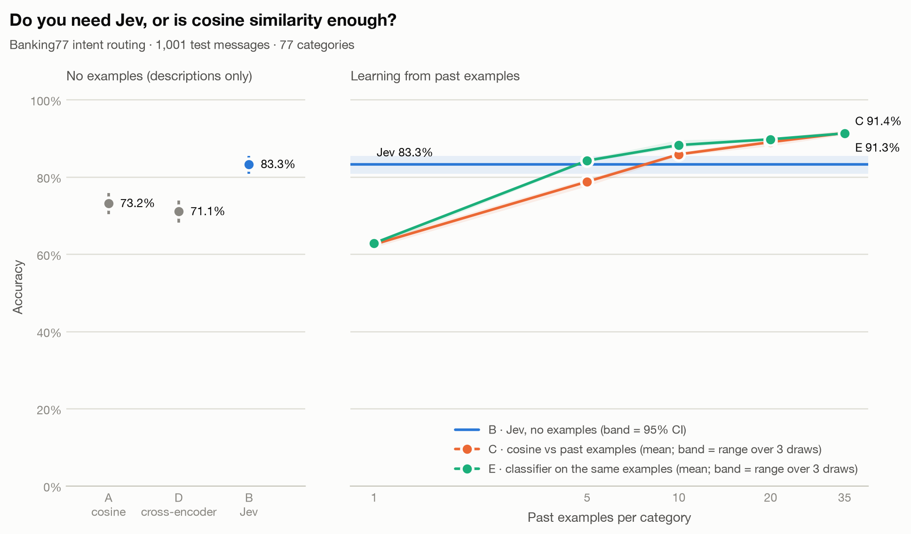

# jev-vs-cosine

**Do you need Jev, or is cosine similarity enough?** A small, reproducible benchmark
comparing [TypeSafe AI's Jev](https://typesafe.ai/blog/introducing-system-one-models-and-jev)
(a "System One" model that returns a typed choice with probabilities instead of text)
against plain embedding cosine similarity, on the
[Banking77](https://github.com/PolyAI-LDN/task-specific-datasets) intent-routing dataset.

It runs at **$0**: cosine similarity and a cross-encoder run locally, and Jev is called
through a free route.

## Results

Jev has answered all **1,001** test messages. OpenCode's free route allows about 250 requests
per IP per day, so the run resumed over several days
([`results/REPORT.md`](results/REPORT.md)):



- **With no examples, Jev (83.3%) beats cosine-vs-descriptions (73.2%) by 10 points.**
- **With just 5 labelled examples per category, a free logistic-regression classifier matches
  Jev** (method E, 84.2%). Plain cosine voting (method C) needs 10 (85.9%). Both reach about
  91% with 35.
- **One example per category (63%) does worse than a one-line description (73%).**
- **A cross-encoder reranker doesn't close the gap.** `bge-reranker-v2-m3` reads each message
  together with each description, much as Jev reads a message with its options, yet on this
  English sample it scores 71.1%. That is no better than plain cosine and 12 points below Jev,
  at about the same time per message (0.8 s on a laptop CPU, against 0.76 s for Jev's network
  round trip). On the harder probe sets below it does beat cosine, by 8 to 14 points.
- **Given the same 5 examples inside its descriptions, Jev reaches 90.4%** (method B+, run on
  the first 249 messages only: [`results/first_249/REPORT.md`](results/first_249/REPORT.md)).
  With those exact examples the classifier scores 86.3% and cosine voting 77.1%. B+ sends about
  3.7 times the input tokens. This is one draw of examples on 249 messages, so the lead over the
  classifier is borderline: B+ alone got 16 messages right and the classifier alone got 6
  (exact McNemar p = 0.05). The lead over cosine voting is clear.

On messages built to be hard, the gap is much wider (no examples for A, D and Jev; 35 per
category for C):

| Probe | Cosine (A) | Cross-encoder (D) | Cosine + 35 examples (C) | Jev (B) |
|---|---|---|---|---|
| [Trick questions](results/probe_tricky.v1/REPORT.md) (105) | 64.8% | 79.0% | 60.6% | **100.0%** |
| [English originals](results/probe_english_source.v1/REPORT.md) (144) | 72.2% | 69.4% | 93.8% | 86.1% |
| [Hinglish](results/probe_hinglish.v1/REPORT.md) (same 144) | 47.9% | 56.2% | 63.7% | **85.4%** |
| [Tanglish](results/probe_tanglish.v1/REPORT.md) (same 144) | 41.7% | 53.5% | 64.6% | **77.1%** |

Claude agents wrote and checked the probe messages; [`probes/README.md`](probes/README.md)
explains how. Read the trick-question row as a worst case for methods that match surface words,
not as typical traffic.

**Is it just the English-only embedder?** Methods A, C and E embed text with
`bge-small-en-v1.5`, which is English-only. Re-running them with the multilingual `bge-m3`,
about 17 times larger ([`results/embedder_bge-m3/`](results/embedder_bge-m3/README.md)),
narrows the gap but does not close it. Best of C and E with 35 examples per category:

| Probe | `bge-small-en` | `bge-m3` (multilingual) | Jev, no examples |
|---|---|---|---|
| English originals (144) | 93.8% | 93.8% | 86.1% |
| Hinglish (144) | 63.7% | 69.9% | **85.4%** |
| Tanglish (144) | 64.6% | 67.6% | **77.1%** |
| Trick questions (105) | 64.1% | 76.5% | **100.0%** |

### When to trust an answer, and when to ask Jev

`python -m app.main triage` replays the saved predictions, so it calls no model
([`results/TRIAGE.md`](results/TRIAGE.md), plus one in each probe folder):

- **Jev's confidence works as a gate.** On the English sample, the 51% of answers where Jev
  reports confidence 1.0 are 98.0% right. At 0.95 or above, 71% of answers are 93.8% right, and
  44 of Jev's 167 mistakes still pass.
- **So does the classifier's own probability.** With 35 examples per category, its answers at
  0.9 or above cover 67% of English messages at 99.1%. On Hinglish and Tanglish only about 43%
  of its answers reach even 0.5, so it signals when it is lost.
- **Cheap first, Jev only when needed.** Accuracy, and the share of messages sent to Jev, with
  35 examples per category:

| Strategy | English | Hinglish | Tanglish | Trick questions |
|---|---|---|---|---|
| Jev alone | 83.3% (all) | **85.4%** (all) | 77.1% (all) | **100.0%** (all) |
| Classifier alone | 91.3% (none) | 56.2% (none) | 52.8% (none) | 64.1% (none) |
| Keep the answer when cosine voting and the classifier agree, else Jev | **92.5%** (7%) | 80.3% (35%) | 75.9% (39%) | 82.9% (30%) |
| Keep the classifier's answer at confidence 0.7 or above, else Jev | 91.6% (16%) | 84.5% (73%) | **78.7%** (75%) | 91.7% (54%) |

The agreement rule is best on English but fails on code-mixed and trick messages, because
cosine voting and the classifier share one English embedding model and agree on the same wrong
answers. The confidence rule adapts to the traffic: it sends Jev about 1 in 6 English messages
and about 3 in 4 code-mixed ones, and is never more than a point below the better single
method on English, Hinglish or Tanglish. On trick questions it reaches 91.7%, because the classifier is
confidently wrong on some traps. The thresholds come from a fixed grid in the code, not tuned
on these results; `TRIAGE.md` also shows 0.9 and 0.5.

## The question, in plain English

A bank's support inbox gets a message like *"I paid at the supermarket and it said
transaction refused."* Which of 77 categories is it (`declined_card_payment`,
`card_arrival`, ...)? Five ways to answer:

| Method | What it compares the message against | Past examples used |
|---|---|---|
| **A: cosine vs descriptions** | A one-line description of each category, e.g. *"A card payment at a shop or online was declined"*. The closest one by meaning wins. | 0 |
| **B: Jev** | The same 77 descriptions, sent to Jev as one `Choice` question. Jev reads the message and picks one. | 0 |
| **C: cosine vs past examples** | Real past customer messages whose category is known. The 5 most similar ones vote. | 1, 5, 10, 20, 35 per category |
| **E: classifier on past examples** | The same past examples as C, used to train a logistic-regression classifier on their embeddings. | 1, 5, 10, 20, 35 per category |
| **D: cross-encoder vs descriptions** | The same 77 descriptions, but a reranker model ([`bge-reranker-v2-m3`](https://huggingface.co/BAAI/bge-reranker-v2-m3)) reads the message and each description *together* and scores the pair. | 0 |

A, B and D get the same category names and descriptions (Jev also receives a one-sentence
instruction), so the difference comes from the method. A encodes the message and each
description *separately*, while D and Jev read them *together*. C shows how many labelled
examples a free, local approach needs before it matches Jev.

## Quickstart

Needs Python 3.12+.

```bash
python3 -m venv .venv && .venv/bin/pip install -e ".[dev]"
cp .env.example .env               # the default block is the free Jev route

.venv/bin/python -m app.main download       # Banking77, pinned commit + SHA-256 checked
.venv/bin/python -m app.main run-cosine     # methods A and C, local and free (~1 min)
.venv/bin/python -m app.main run-cross-encoder   # method D, local and free (~15 min, 2.3 GB model)
.venv/bin/python -m app.main run-trained    # method E, local and free (~30 s)
.venv/bin/python -m app.main verify-route  # check the route answers like TypeSafe (6 calls)
.venv/bin/python -m app.main run-jev --limit 20 --dry-run   # estimate, calls nothing
.venv/bin/python -m app.main run-jev --limit 20             # pilot
.venv/bin/python -m app.main run-jev                        # all 1,001 test messages
.venv/bin/python -m app.main report         # results/REPORT.md + the chart
.venv/bin/python -m app.main triage         # results/TRIAGE.md: thresholds and cascades, no calls
```

`run-jev` caches every answer as it goes. If a run stops (rate limit, daily cap, budget),
run it again and it resumes without paying twice for any message.

## Free ways to call Jev (checked 2026-09-24)

| Route | Cost | Needs | Notes |
|---|---|---|---|
| **OpenCode Zen** `jev-1.13-free` (default) | $0 | nothing (anonymous) | Per-IP daily request cap, value unpublished, resets 00:00 UTC; "limited time" |
| Vercel AI Gateway `typesafe-ai/jev` | $0 from the $5/month free credit | a credit card on file | Heavily throttled on the free tier; model id is unversioned |
| TypeSafe direct `jev-1.13.0` | $5 signup credit | an existing console account | New signups paused since 2026-09-22 |
| OpenRouter, Cloudflare | paid | credits | Not free for Jev |

**Is the free route really TypeSafe's Jev?** It is a third party, so the benchmark checks rather
than trusts. `python -m app.main verify-route` replays six published TypeSafe answers through the
configured route. All six must give the same decisions with probabilities within 0.05. The two
dated live recordings must also match token counts exactly (422/422 and 476/476). The four
undated docs examples differ by 9 to 33 tokens, likely an older prompt template, so their counts
are advisory. The daily script repeats one dated recording as a drift canary before spending
quota. A match is strong evidence, not proof: see
[`fingerprints/README.md`](fingerprints/README.md) for the evidence and its limits.

Beware of lookalike "Jev API" sites and packages. The only official packages are PyPI
`typesafe-sdk` / `system-one-adapter` and npm `@typesafe-ai/sdk`. `JEV_BASE_URL` is checked
against an allow-list so a key can't be sent to a typo or a reseller.

## How the experiment stays fair and reproducible

- **Same test set for every method:** 13 messages from each of the 77 categories
  (1,001 total) from the Banking77 *test* split, fixed seed.
- **Same category text for A and B:** names and one-line descriptions live in one
  versioned file, [`prompts/banking77_intents.v1.json`](prompts/banking77_intents.v1.json).
  A embeds "name: description". Jev gets the same names and descriptions as `Choice` options,
  plus the file's one-sentence instruction. The descriptions were written from the category
  names only, without looking at any test message.
- **Tuned only on training data:** method E's regularisation (`C=100`) was chosen on 1,500
  held-out *training* messages, never on the test set. The scikit-learn default `C=1` underfit
  by 2-4 points there.
- **No train/test leaks:** 7 training rows that duplicate a test message (ignoring case and
  whitespace, an upstream Banking77 quirk) are removed before any past examples are drawn.
- **Nested, repeated examples for C:** the 5 examples used at 5-per-category are also among
  the 10 used at 10-per-category, so the curve measures *more* examples, not *different*
  ones. Every size is drawn with 3 random seeds, and the chart shows the range. The grid
  stops at 35 because the smallest Banking77 training category has 35 messages.
- **Everything pinned:** the dataset commit plus file checksums, the embedding and reranker
  model revisions (`BAAI/bge-small-en-v1.5@5c38ec7`, `BAAI/bge-reranker-v2-m3@953dc6f`), the
  prompt version, and the Jev route. Each run saves
  its route, the model the route reported, the prompt version and the price next to its
  results (`*.meta.json`), and the report reads them from there, not from your current `.env`.
- **Latency:** A and C time local CPU embedding plus scoring per message. Reference texts are
  pre-embedded, as a live system would do. D times all 77 (message, description) pairs for
  one message on CPU; nothing can be precomputed, because each pair includes the message. Jev time is the full network round trip from
  wherever you run it, including any retry waits on routes with retries enabled (the
  default free route has them off).

## Safety rails for a free budget

- **Hard token ceiling** (`JEV_MAX_TOTAL_INPUT_TOKENS`, default 3M). It counts earlier cached
  runs too, and refuses the call that would cross it rather than warning after.
- **Answer cache** (`.cache/jev_decisions.jsonl`), append-only and keyed by route, model,
  prompt fingerprint and message. It stores no message text. It is committed to git, because
  each answer spends free daily quota and a lost cache would mean paying for it again.
- **Pacing and retries** are configurable per route, because OpenCode counts retries
  against its daily cap.
- **The key never leaves `.env`:** it is held in a `SecretStr`, masked by a logging filter,
  and TypeSafe SDK body logging is silenced.

## Project layout

```
app/
  domain/        pure types and scoring (stdlib only): metrics, catalog, results
  services/      use cases: sampling, cosine voting, cross-encoder, trained classifier, Jev
                 runner, budget, report, chart, triage
  services/ports Protocols (Embedder, PairScorer, ClassifierTrainer, JevDecider)
  repositories/  dataset files, prompt catalog, Jev answer cache, results
  clients/       adapters: TypeSafe SDK, sentence-transformers, scikit-learn
  core/          settings, logging, run id
  main.py        CLI: download | run-cosine | run-cross-encoder | run-trained | run-jev |
                 verify-route | report | triage
prompts/         versioned category descriptions (the "prompt")
results/         committed outputs: REPORT.md, chart, per-message predictions
tests/unit/      pytest suite mirroring app/
```

## Quality gates

```bash
.venv/bin/ruff format --check . && .venv/bin/ruff check .
.venv/bin/mypy --strict app
.venv/bin/pytest -q --cov=app --cov-fail-under=85
.venv/bin/pip-audit --skip-editable
```

CI runs the same gates on every push and pull request (`.github/workflows/ci.yml`).

## Data and credits

[Banking77](https://github.com/PolyAI-LDN/task-specific-datasets) is by PolyAI (Casanueva et
al., 2020), licensed CC BY 4.0. `results/predictions/` repeats test-split messages next to
each method's answers, for error analysis.

## Limitations

- One dataset (English banking intents, mostly topic-like categories, where cosine is
  strong). Judgement-heavy tasks may look very different.
- One main embedding model (`bge-small-en-v1.5`, English-only, chosen for speed on a laptop).
  The multilingual `bge-m3` was also run for methods A, C and E
  ([`results/embedder_bge-m3/`](results/embedder_bge-m3/README.md)); other models may score
  higher.
- One cross-encoder (`bge-reranker-v2-m3`, trained for search relevance, not classification).
  A 2026 zero-shot benchmark ([BTZSC](https://arxiv.org/abs/2603.11991)) found larger rerankers
  such as Qwen3-Reranker-8B do much better, so D is a lower bound for the approach.
- Banking77 is public, so Jev and the embedding models may have seen it in training. Only the
  trick-question probe is new text.
- Jev results come from a free route. If you change the route, compare within one route,
  not across routes.
- Jev latency depends heavily on distance to its US-hosted servers.

## License

Code: [MIT](LICENSE). The Banking77 data and the messages quoted in `results/predictions/`
stay under PolyAI's CC BY 4.0.
