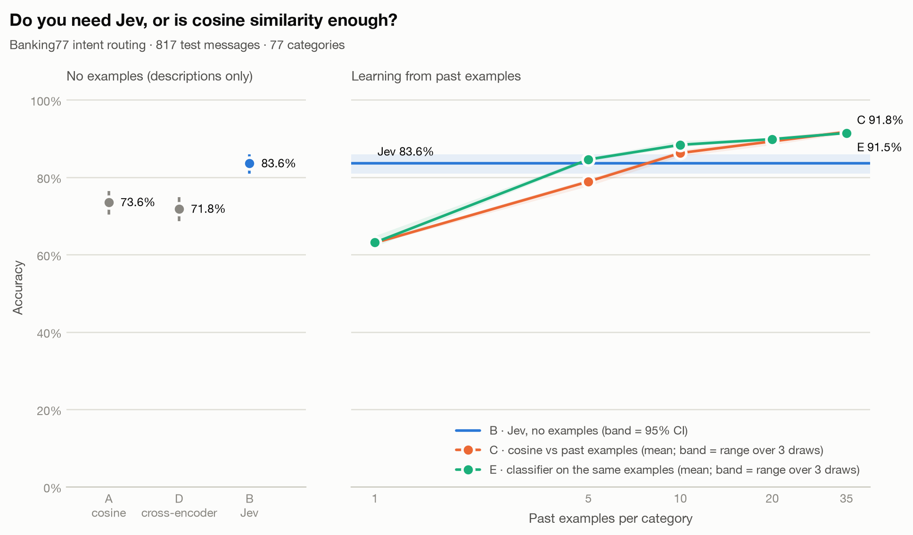

# jev-vs-cosine

**Do you need Jev, or is cosine similarity enough?** A small, reproducible benchmark
comparing [TypeSafe AI's Jev](https://typesafe.ai/blog/introducing-system-one-models-and-jev)
(a "System One" model that returns a typed choice with probabilities instead of text)
against plain embedding cosine similarity, on the
[Banking77](https://github.com/PolyAI-LDN/task-specific-datasets) intent-routing dataset.

It ran at **$0**: cosine similarity, a cross-encoder and a classifier run locally, and Jev was
called through OpenCode's free route, which has since closed to direct API calls (see
[Free ways to call Jev](#free-ways-to-call-jev-checked-2026-10-27)).

## Results

Jev answered **817 of the 1,001** sampled test messages (13 per category) before the free route
closed. Every method below is scored on exactly those 817 messages
([`results/first_817/REPORT.md`](results/first_817/REPORT.md)):



| Method | Past examples per category | Accuracy (95% CI) |
|---|---|---|
| A · cosine vs descriptions | 0 | 73.6% (70.4–76.5%) |
| **B · Jev** | 0 | **83.6% (80.9–86.0%)** |
| D · cross-encoder vs descriptions | 0 | 71.8% (68.7–74.8%) |
| C · cosine vs past examples (top-5 vote) | 5 / 10 / 35 | 78.9% / 86.3% / 91.8% |
| E · classifier on past examples | 5 / 10 / 35 | 84.6% / 88.4% / 91.5% |

C and E are means over 3 random draws of the examples.

- **With no examples, Jev beats cosine-vs-descriptions by 10 points** (83.6% vs 73.6%).
- **With just 5 labelled examples per category, a free logistic-regression classifier matches
  Jev** (method E, 84.6%). Plain cosine voting (method C) needs about 10 (86.3%). Both reach
  about 92% with 35.
- **One example per category (63%) does worse than a one-line description (74%).**
- **A cross-encoder reranker doesn't close the gap.** `bge-reranker-v2-m3` reads each message
  together with each description, much as Jev reads a message with its options, yet it scores
  71.8%, no better than plain cosine and 12 points below Jev, at about the same latency
  (0.86 s per message on a laptop CPU vs 0.78 s for a Jev round trip).
- **Examples help Jev too.** Given the same 5 past examples per category inside its
  descriptions, Jev scored 90.4% on the first 249 messages, against 83.1% without them and
  86.3% for E with those exact examples ([`results/first_249/REPORT.md`](results/first_249/REPORT.md)).

### Where Jev clearly wins: hard and code-mixed messages

[Probe sets](probes/README.md) aimed at known weaknesses of surface matching. C and E use 35
past examples per category, their best setting on Banking77.

| Probe (messages) | A · cosine | B · Jev | D · cross-encoder | C · 35 examples | E · 35 examples |
|---|---|---|---|---|---|
| Tricky: negation, distractors, indirect requests (105) | 64.8% | **100.0%** | 79.0% | 60.6% | 64.1% |
| English originals (144) | 72.2% | 86.1% | 69.4% | **93.8%** | 93.1% |
| Same messages in Hinglish (144) | 47.9% | **85.4%** | 56.2% | 63.7% | 56.2% |
| Same messages in Tanglish (144) | 41.7% | **77.1%** | 53.5% | 64.6% | 52.8% |

- With 35 examples per category, the example-based methods beat Jev on ordinary English, but
  **fall to about 61-65% on the tricky set, where Jev gets every message right.**
- **Code-mixing costs Jev under 1 point (Hinglish) to 9 (Tanglish), the multilingual
  cross-encoder 13-16, and the embedding methods (A, C, E) 24-40.** Their embedding model (`bge-small-en-v1.5`) is English-only, so this
  measures what happens when an English pipeline meets Indian code-mixed chat, not the best
  multilingual embedder.
- The probes were written and checked by LLM agents, not people; see
  [`probes/README.md`](probes/README.md) for how and the limits.

### Not covered

- **The last 184 messages.** Jev never answered them. All five methods use the same 817, so the
  comparison is like for like. The cosine, cross-encoder and classifier methods on all 1,001
  are in [`results/REPORT.md`](results/REPORT.md) and differ from their 817-message scores by
  less than one point.
- **Only Jev 1.13.** TypeSafe has since released Jev 1.14 (on OpenRouter and Vercel). The
  free route served 1.13 and matched TypeSafe's published 1.13 answers every day it was used
  ([`fingerprints/README.md`](fingerprints/README.md)).

## The question, in plain English

A bank's support inbox gets a message like *"I paid at the supermarket and it said
transaction refused."* Which of 77 categories is it (`declined_card_payment`,
`card_arrival`, ...)? Five ways to answer:

| Method | What it compares the message against | Past examples used |
|---|---|---|
| **A: cosine vs descriptions** | A one-line description of each category, e.g. *"A card payment at a shop or online was declined"*. The closest one by meaning wins. | 0 |
| **B: Jev** | The same 77 descriptions, sent to Jev as one `Choice` question. Jev reads the message and picks one. | 0 |
| **C: cosine vs past examples** | Real past customer messages whose category is known. The 5 most similar ones vote. | 1, 5, 10, 20, 35 per category |
| **E: classifier on past examples** | The same past examples as C, used to train a logistic-regression classifier on their embeddings. | 1, 5, 10, 20, 35 per category |
| **D: cross-encoder vs descriptions** | The same 77 descriptions, but a reranker model ([`bge-reranker-v2-m3`](https://huggingface.co/BAAI/bge-reranker-v2-m3)) reads the message and each description *together* and scores the pair. | 0 |

A, B and D get the same category names and descriptions (Jev also receives a one-sentence
instruction), so the difference comes from the method. A encodes the message and each
description *separately*, while D and Jev read them *together*. C shows how many labelled
examples a free, local approach needs before it matches Jev.

## Quickstart

Needs Python 3.12+.

```bash
python3 -m venv .venv && .venv/bin/pip install -e ".[dev]"
cp .env.example .env               # pick a Jev route; the free one is now closed (see below)

.venv/bin/python -m app.main download       # Banking77, pinned commit + SHA-256 checked
.venv/bin/python -m app.main run-cosine     # methods A and C, local and free (~1 min)
.venv/bin/python -m app.main run-cross-encoder   # method D, local and free (~15 min, 2.3 GB model)
.venv/bin/python -m app.main run-trained    # method E, local and free (~30 s)
.venv/bin/python -m app.main verify-route  # check the route answers like TypeSafe (6 calls)
.venv/bin/python -m app.main run-jev --limit 20 --dry-run   # estimate, calls nothing
.venv/bin/python -m app.main run-jev --limit 20             # pilot
.venv/bin/python -m app.main run-jev                        # all 1,001 test messages
.venv/bin/python -m app.main report         # results/REPORT.md + the chart
```

`run-jev` caches every answer as it goes. If a run stops (rate limit, daily cap, budget),
run it again and it resumes without paying twice for any message.

## Free ways to call Jev (checked 2026-10-27)

| Route | Cost | Needs | Notes |
|---|---|---|---|
| **OpenCode Zen** `jev-1.13-free` (used here) | $0 | nothing (anonymous) | **Closed to direct API calls since about 2026-10-25.** Every request returns `429 FreeUsageLimitError` ("Free models work in OpenCode"). OpenCode's issue bot says free models are now [served only to the OpenCode client](https://github.com/anomalyco/opencode/issues/58995). Before that: a per-IP daily cap of about 250 requests, resetting at 00:00 UTC |
| Vercel AI Gateway `typesafe-ai/jev` | paid | purchased credits | Jev is not among the [free-tier models](https://vercel.com/ai-gateway/models?freeTier=true) |
| TypeSafe direct `jev-1.13.0` | paid | a console account | No published free tier; new signups paused since 2026-09-22 |
| OpenRouter, Cloudflare | paid | credits | Not free for Jev |

At list price ($0.042 per million input tokens), a full 1,001-message run costs about $0.17,
so a paid route is the practical way to reproduce Jev's numbers now. Paid routes are cached
under their own route id, so they never mix with the answers committed here.

**Is the free route really TypeSafe's Jev?** It is a third party, so the benchmark checks rather
than trusts. `python -m app.main verify-route` replays six published TypeSafe answers through the
configured route and compares token counts exactly, decisions exactly, and probabilities within
0.05. The daily script repeats one of them as a drift canary before spending quota. See
[`fingerprints/README.md`](fingerprints/README.md) for the evidence and its limits.

Beware of lookalike "Jev API" sites and packages. The only official packages are PyPI
`typesafe-sdk` / `system-one-adapter` and npm `@typesafe-ai/sdk`. `JEV_BASE_URL` is checked
against an allow-list so a key can't be sent to a typo or a reseller.

## How the experiment stays fair and reproducible

- **Same test set for every method:** 13 messages from each of the 77 categories
  (1,001 total) from the Banking77 *test* split, fixed seed.
- **Same category text for A and B:** names and one-line descriptions live in one
  versioned file, [`prompts/banking77_intents.v1.json`](prompts/banking77_intents.v1.json).
  A embeds "name: description". Jev gets the same names and descriptions as `Choice` options,
  plus the file's one-sentence instruction. The descriptions were written from the category
  names only, without looking at any test message.
- **Tuned only on training data:** method E's regularisation (`C=100`) was chosen on 1,500
  held-out *training* messages, never on the test set. The scikit-learn default `C=1` underfit
  by 2-4 points there.
- **No train/test leaks:** 7 training rows that duplicate a test message (ignoring case and
  whitespace, an upstream Banking77 quirk) are removed before any past examples are drawn.
- **Nested, repeated examples for C:** the 5 examples used at 5-per-category are also among
  the 10 used at 10-per-category, so the curve measures *more* examples, not *different*
  ones. Every size is drawn with 3 random seeds, and the chart shows the range. The grid
  stops at 35 because the smallest Banking77 training category has 35 messages.
- **Everything pinned:** the dataset commit plus file checksums, the embedding and reranker
  model revisions (`BAAI/bge-small-en-v1.5@5c38ec7`, `BAAI/bge-reranker-v2-m3@953dc6f`), the
  prompt version, and the Jev route. Each run saves
  its route, the model the route reported, the prompt version and the price next to its
  results (`*.meta.json`), and the report reads them from there, not from your current `.env`.
- **Latency:** A and C time local CPU embedding plus scoring per message. Reference texts are
  pre-embedded, as a live system would do. D times all 77 (message, description) pairs for
  one message on CPU; nothing can be precomputed, because each pair includes the message. Jev time is the full network round trip from
  wherever you run it, including any retry waits on routes with retries enabled (the
  default free route has them off).

## Safety rails for a free budget

- **Hard token ceiling** (`JEV_MAX_TOTAL_INPUT_TOKENS`, default 3M). It counts earlier cached
  runs too, and refuses the call that would cross it rather than warning after.
- **Answer cache** (`.cache/jev_decisions.jsonl`), append-only and keyed by route, model,
  prompt fingerprint and message. It stores no message text. It is committed to git, because
  each answer spends free daily quota and a lost cache would mean paying for it again.
- **Pacing and retries** are configurable per route, because OpenCode counts retries
  against its daily cap.
- **The key never leaves `.env`:** it is held in a `SecretStr`, masked by a logging filter,
  and TypeSafe SDK body logging is silenced.

## Project layout

```
app/
  domain/        pure types and scoring (stdlib only): metrics, catalog, results
  services/      use cases: sampling, cosine voting, cross-encoder, trained classifier, Jev
                 runner, budget, report, chart
  services/ports Protocols (Embedder, PairScorer, ClassifierTrainer, JevDecider)
  repositories/  dataset files, prompt catalog, Jev answer cache, results
  clients/       adapters: TypeSafe SDK, sentence-transformers, scikit-learn
  core/          settings, logging, run id
  main.py        CLI: download | run-cosine | run-cross-encoder | run-trained | run-jev | report
prompts/         versioned category descriptions (the "prompt")
results/         committed outputs: REPORT.md, chart, per-message predictions
tests/unit/      pytest suite mirroring app/
```

## Quality gates

```bash
.venv/bin/ruff format --check . && .venv/bin/ruff check .
.venv/bin/mypy --strict app
.venv/bin/pytest -q --cov=app --cov-fail-under=85
.venv/bin/pip-audit --skip-editable
```

CI runs the same gates on every push and pull request (`.github/workflows/ci.yml`).

## Data and credits

[Banking77](https://github.com/PolyAI-LDN/task-specific-datasets) is by PolyAI (Casanueva et
al., 2020), licensed CC BY 4.0. `results/predictions/` repeats test-split messages next to
each method's answers, for error analysis.

## Limitations

- One dataset (English banking intents, mostly topic-like categories, where cosine is
  strong). Judgement-heavy tasks may look very different.
- One embedding model (`bge-small`, chosen for speed on a laptop). Larger ones may score higher.
- One cross-encoder (`bge-reranker-v2-m3`, trained for search relevance, not classification).
  A 2026 zero-shot benchmark ([BTZSC](https://arxiv.org/abs/2603.11991)) found larger rerankers
  such as Qwen3-Reranker-8B do much better, so D is a lower bound for the approach.
- Jev results come from a free route. If you change the route, compare within one route,
  not across routes.
- Jev latency depends heavily on distance to its US-hosted servers.

## License

Code: [MIT](LICENSE). The Banking77 data and the messages quoted in `results/predictions/`
stay under PolyAI's CC BY 4.0.
