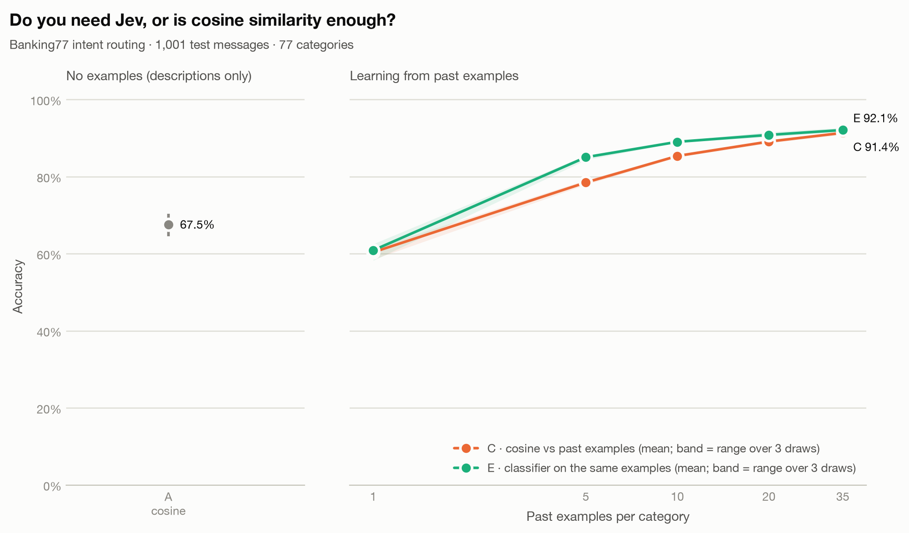

# Results: Jev vs cosine similarity on Banking77

_Jev (method B) has not been run yet; only the cosine methods are shown._

A classifier trained on the same past examples (method E) reaches **92.1%** with 35 per category.

| Method | Past examples per category | Accuracy (95% CI) | Median latency | p95 latency | Input tokens | List-price cost |
|---|---|---|---|---|---|---|
| A · cosine vs descriptions | 0 | 67.5% (64.6%–70.4%) | 48 ms | 53 ms | 0 | $0.0000 |
| C · cosine vs past examples (top-5 vote) | 1 | 60.4% (range 58.5%–61.4% over 3 draws) | 48 ms | 53 ms | 0 | $0.0000 |
| C · cosine vs past examples (top-5 vote) | 5 | 78.5% (range 77.9%–79.1% over 3 draws) | 48 ms | 53 ms | 0 | $0.0000 |
| C · cosine vs past examples (top-5 vote) | 10 | 85.4% (range 85.0%–85.7% over 3 draws) | 48 ms | 53 ms | 0 | $0.0000 |
| C · cosine vs past examples (top-5 vote) | 20 | 89.1% (range 88.7%–89.4% over 3 draws) | 48 ms | 53 ms | 0 | $0.0000 |
| C · cosine vs past examples (top-5 vote) | 35 | 91.4% (range 90.9%–91.7% over 3 draws) | 48 ms | 53 ms | 0 | $0.0000 |
| E · classifier trained on past examples | 1 | 60.9% (range 58.2%–62.5% over 3 draws) | 45 ms | 49 ms | 0 | $0.0000 |
| E · classifier trained on past examples | 5 | 85.0% (range 84.3%–85.5% over 3 draws) | 45 ms | 49 ms | 0 | $0.0000 |
| E · classifier trained on past examples | 10 | 89.0% (range 88.9%–89.2% over 3 draws) | 45 ms | 49 ms | 0 | $0.0000 |
| E · classifier trained on past examples | 20 | 90.8% (range 90.3%–91.6% over 3 draws) | 45 ms | 49 ms | 0 | $0.0000 |
| E · classifier trained on past examples | 35 | 92.1% (range 91.7%–92.7% over 3 draws) | 45 ms | 49 ms | 0 | $0.0000 |

## How to read this

- Every method answered the same 1,001 test messages from the Banking77 test split. The full sample is 13 per category x 77 categories = 1,001, shuffled; a smaller count means the first N of that sample.
- A embeds each category's name plus its one-line description. B (Jev) gets the same names and descriptions as Choice options, plus a one-sentence instruction. C compares against past customer messages from the training split (1, 5, 10, 20, 35 per category), drawn with 3 random seeds; 7 training rows that duplicated a test message (ignoring case and whitespace) were removed first.
- Prompt catalog: `banking77_intents.v1`. Embedding model: `BAAI/bge-m3@5617a9f61b028005a4858fdac845db406aefb181`, run locally on CPU (free). Jev: not run.
- D scores (message, name + description) for every category with a cross-encoder reranker (`not run`), 77 pairs per message, locally on CPU, with no examples. Its latency is all 77 pairs for one message.
- E trains a logistic-regression classifier on the embeddings of the same past examples C votes with (same seeds, same messages). Training is offline and untimed.
- B+ appends the seed-1 past examples C and E use at that setting to each of Jev's category descriptions, so its catalog, token count and cache namespace differ from B.
- Latency for A and C is local embedding plus scoring per message. For Jev it is the full network round trip, including retry waits on routes with retries enabled.
- List-price cost is what the run would cost at $0.042 per million input tokens, even when the route used was free.
